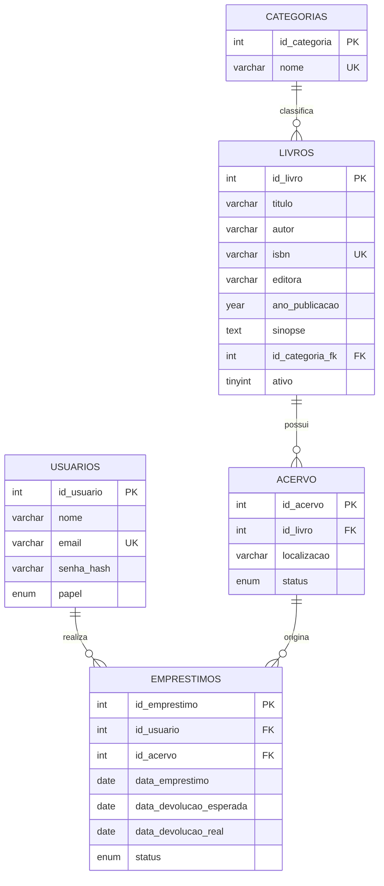

# BiblioTech 📚

Sistema web de **gestão de biblioteca** desenvolvido para a disciplina de Banco de Dados.
O site está **publicado e disponível para uso** — não é necessário instalar nada para avaliá-lo.

> 🔗 **Site:** `https://bibliotech-6dds.onrender.com`

Como o site está hospedado no plano gratuito do Render, ele **hiberna após ~15 minutos sem
acessos**. A primeira visita depois disso demora de 30 a 60 segundos para responder — é
comportamento da hospedagem, não do sistema.

---

## 1. O que o sistema faz

Uma biblioteca trabalha com três coisas: **livros**, **exemplares físicos** e **empréstimos**.
O BiblioTech cobre esse ciclo completo:

- mantém o catálogo de livros com seus dados bibliográficos;
- controla quantos exemplares existem de cada título e onde estão guardados;
- registra empréstimos, calcula a devolução prevista e registra a devolução real;
- mostra números da biblioteca (acervo, empréstimos em aberto, atrasos);
- separa o que um leitor comum pode fazer do que só o administrador pode.

Há dois perfis de acesso:

| Perfil | Pode fazer |
|---|---|
| **Usuário** | Consultar o catálogo, emprestar para si mesmo e devolver os próprios empréstimos |
| **Dev** | Tudo do usuário + cadastrar/editar/excluir livros, gerenciar contas e emprestar/devolver para qualquer pessoa |

O cadastro aberto sempre cria conta **Usuário**. Ninguém se torna Dev sozinho: só outro Dev
promove, na tela *Usuários*.

---

## 2. As telas do sistema

| Tela | O que apresenta |
|---|---|
| **Início** (`/src/index.html`) | Três cartões (livros cadastrados, empréstimos ativos, usuários) e a tabela dos 10 empréstimos mais recentes com o status de cada um |
| **Livros** (`src/pages/catalogo-livros.html`) | Catálogo em tabela: título, autor, categoria, ano, disponibilidade. Busca por título/autor/ISBN, filtros por categoria e disponibilidade, 5 registros por página. Para o Dev, a coluna **Ações** traz editar e excluir |
| **Emprestar Livro** (`src/pages/emprestimos.html`) | Seletor apenas com livros que têm exemplar livre, data do empréstimo e, para o Dev, o seletor de usuário. A data prevista de devolução é calculada pelo servidor (14 dias) |
| **Devolver Livro** (`src/pages/devolucao.html`) | Seletor apenas com empréstimos em aberto (o Dev vê os de todos; o usuário vê só os dele), data real da devolução e confirmação |
| **Usuários** (`src/pages/usuarios-cadastrados.html`) | Lista de contas com nome, e-mail, permissão e ações. Só para Dev |
| **Cadastrar Usuário** (`src/pages/cadastro-usuarios.html`) | Formulário de nova conta com permissão inicial. Só para Dev |
| **Cadastrar Livro** (`src/pages/cadastro-livros.html`) | Formulário completo do livro, incluindo **quantidade de exemplares** e localização física. Só para Dev |
| **Consulta** (`src/pages/consulta.html`) | Relatório geral: total de empréstimos, usuários com empréstimo ativo e atrasos registrados |
| **Login / Criar conta** | Entrada no sistema e autocadastro de leitor |

O menu lateral muda conforme o perfil: as três telas de gestão simplesmente não aparecem para
um usuário comum. E, se ele digitar a URL na mão, recebe a tela **Acesso restrito** — a
permissão é conferida no servidor, não só escondida no HTML.

---

## 3. Arquitetura

O projeto não usa framework: é Node.js puro no back-end e HTML/CSS/JavaScript no front-end.

```
 Navegador (HTML + CSS + JS)                Servidor Node                        Banco
 ┌────────────────────────┐   fetch   ┌──────────────────────────┐  mysql2  ┌──────────────────┐
 │ src/index.html         │  ───────▶ │ src/back-end/server.js   │ ───────▶ │ TiDB Cloud       │
 │ src/pages/*.html       │   /api    │ • serve os arquivos      │  (pool)  │ (MySQL 8         │
 │ src/script.js          │  ◀─────── │ • API JSON + permissões  │ ◀─────── │  compatível)     │
 │ src/style.css          │   JSON    │ • regras de negócio      │          │ BIBLIOTECA_BD    │
 └────────────────────────┘           └──────────────────────────┘          └──────────────────┘
```

- **`server.js`** usa o módulo `http` do Node, serve os arquivos estáticos e responde a API
  JSON em `/api`. Sessão, validação e regras de negócio ficam todas aqui — o navegador nunca
  fala com o banco.
- **`connectionDB.js`** mantém um **pool** de conexões com o MySQL e aceita porta e TLS por
  variável de ambiente (necessário no banco hospedado).
- **`script.js`** concentra as telas: chama a API com `fetch`, monta as tabelas, filtros,
  paginação e modais.
- **`senhas.js`** faz o hash das senhas (`scrypt` com salt) e gera os tokens de sessão.

---

## 4. Modelo de dados

Cinco tabelas. O ponto central do modelo é separar o **título** do **exemplar físico**:



**Por que `livros` e `acervo` são tabelas diferentes?** Porque a biblioteca pode ter 3 cópias
de *Dom Casmurro*. Os dados bibliográficos (título, autor, ISBN) ficam em `livros`, uma única
vez; cada cópia física é uma linha de `acervo`, com sua `localizacao` (estante) e seu `status`
(`Disponivel`, `Emprestado`, `Indisponivel`). Assim o sistema sabe **quantos** exemplares
existem e **quais** estão livres, sem repetir o título.

**Por que o empréstimo aponta para `acervo` e não para `livros`?** Porque o que sai da estante é
um exemplar específico. É esse vínculo que permite devolver *aquele* exemplar e deixá-lo
disponível de novo, sem interferir nas outras cópias do mesmo título.

Decisões de integridade:

| Recurso | Onde | Para quê |
|---|---|---|
| `PRIMARY KEY AUTO_INCREMENT` | todas | identidade de cada registro |
| `UNIQUE` | `livros.isbn`, `usuarios.email`, `categorias.nome` | impede duplicidade de ISBN, e-mail e categoria |
| `FOREIGN KEY ... ON DELETE RESTRICT` | `livros`, `acervo`, `emprestimos` | impede apagar um livro/usuário que tenha histórico |
| `ENUM` | `usuarios.papel`, `acervo.status`, `emprestimos.status` | só aceita os estados previstos |
| `CHECK` | `emprestimos` | data de devolução coerente com a do empréstimo e status compatível com a data real |
| `INDEX` | `acervo(id_livro, status)`, `emprestimos(id_usuario)`, `emprestimos(id_acervo, status)` | acelera as consultas mais usadas |
| `livros.ativo` | `livros` | exclusão lógica: o livro sai do catálogo sem perder o histórico |

---

## 5. O CRUD no site

Cada operação do CRUD tem um lugar visível na interface. Esta é a correspondência entre a
tela, a rota da API e o comando SQL executado:

| CRUD | Onde aparece no site | Rota | SQL |
|---|---|---|---|
| **C**reate | Cadastrar Livro | `POST /api/livros` | `INSERT INTO livros` + N × `INSERT INTO acervo` |
| **C**reate | Criar conta (autocadastro) | `POST /api/contas` | `INSERT INTO usuarios` |
| **C**reate | Usuários → Cadastrar usuário | `POST /api/usuarios` | `INSERT INTO usuarios` |
| **C**reate | Emprestar Livro | `POST /api/emprestimos` | `INSERT INTO emprestimos` + `UPDATE acervo` |
| **R**ead | Livros (catálogo) | `GET /api/livros` | `SELECT` com `JOIN`, `GROUP BY` e `SUM(CASE ...)` |
| **R**ead | Início (cartões) e Consulta | `GET /api/dashboard` | `SELECT` com subconsultas de `COUNT` |
| **R**ead | Início (tabela) e seletores | `GET /api/emprestimos` | `SELECT` com 3 `JOIN` + `ORDER BY` + `LIMIT` |
| **R**ead | Usuários | `GET /api/usuarios` | `SELECT ... ORDER BY papel, nome` |
| **U**pdate | Livros → lápis | `PUT /api/livros/:id` | `UPDATE livros` |
| **U**pdate | Usuários → seletor de permissão | `PUT /api/usuarios/:id` | `UPDATE usuarios SET papel` |
| **U**pdate | Devolver Livro | `POST /api/devolucoes` | `UPDATE emprestimos` + `UPDATE acervo` |
| **D**elete | Livros → lixeira | `DELETE /api/livros/:id` | `UPDATE livros SET ativo = 0` |
| **D**elete | Usuários → lixeira | `DELETE /api/usuarios/:id` | `DELETE FROM usuarios` |

### Create — cadastro de livro e geração dos exemplares

O formulário pede os dados bibliográficos, a categoria, a **quantidade** e a localização.
O servidor abre uma transação e:

1. procura a categoria pelo nome (`SELECT ... WHERE nome = ?`); se não existir, cria
   (`INSERT INTO categorias`) — por isso o formulário aceita categoria nova sem tela separada;
2. insere o livro em `livros`;
3. insere **uma linha em `acervo` para cada unidade** informada, já com
   `status = 'Disponivel'`.

Se qualquer passo falhar (por exemplo ISBN repetido, que é `UNIQUE`), a transação sofre
`rollback` e nada é gravado — não fica livro sem exemplar nem exemplar órfão.

### Create — empréstimo com reserva de exemplar

Emprestar não é só um `INSERT`: é preciso escolher **um** exemplar livre e marcá-lo como
emprestado, sem que duas pessoas peguem a mesma cópia ao mesmo tempo. O servidor faz, dentro de
uma transação:

```sql
SELECT id_acervo FROM acervo
 WHERE id_livro = ? AND status = 'Disponivel'
 ORDER BY id_acervo LIMIT 1
 FOR UPDATE;                                   -- tranca a linha escolhida

INSERT INTO emprestimos (id_usuario, id_acervo, data_emprestimo,
                         data_devolucao_esperada, status)
VALUES (?, ?, ?, ?, 'Ativo');

UPDATE acervo SET status = 'Emprestado' WHERE id_acervo = ?;
```

O `FOR UPDATE` é o que evita a corrida entre dois empréstimos simultâneos. A data prevista de
devolução não vem do formulário: é calculada pelo servidor somando 14 dias à data do
empréstimo (configurável por `DIAS_EMPRESTIMO`). Um usuário comum empresta sempre para a própria
conta — o `idUsuario` enviado pelo navegador só é aceito quando a sessão é de um Dev.

### Read — catálogo com contagem de disponíveis

A tela de livros não guarda “quantidade” em lugar nenhum: ela é **derivada** do acervo.

```sql
SELECT l.id_livro, l.titulo, l.autor, l.isbn, l.editora, l.ano_publicacao,
       l.sinopse, c.nome AS categoria,
       SUM(CASE WHEN a.status = 'Disponivel' THEN 1 ELSE 0 END) AS disponiveis,
       COUNT(a.id_acervo) AS total
  FROM livros l
  JOIN categorias c ON c.id_categoria = l.id_categoria_fk
  LEFT JOIN acervo a ON a.id_livro = l.id_livro
 WHERE l.ativo = 1
 GROUP BY l.id_livro, l.titulo, l.autor, l.isbn, l.editora, l.ano_publicacao, l.sinopse, c.nome
 ORDER BY l.titulo;
```

`COUNT` dá o total de exemplares, `SUM(CASE ...)` dá quantos estão livres, e o `LEFT JOIN`
garante que um livro sem nenhum exemplar ainda apareça (com zero). A busca por texto, os
filtros de categoria/disponibilidade e a paginação de 5 itens são feitos no navegador sobre
esse resultado — decisão simples e suficiente para o volume de um trabalho acadêmico.

### Read — números do Início e da Consulta

Os cartões vêm de uma única consulta com subselects, para não fazer cinco idas ao banco:

```sql
SELECT (SELECT COUNT(*) FROM livros WHERE ativo = 1)                          AS livros,
       (SELECT COUNT(*) FROM emprestimos WHERE status = 'Ativo')              AS emprestimosAtivos,
       (SELECT COUNT(*) FROM usuarios)                                        AS usuarios,
       (SELECT COUNT(DISTINCT id_usuario) FROM emprestimos WHERE status='Ativo') AS usuariosAtivos,
       (SELECT COUNT(*) FROM emprestimos)                                     AS totalEmprestimos,
       (SELECT COUNT(*) FROM emprestimos
         WHERE status = 'Devolvido'
           AND data_devolucao_real > data_devolucao_esperada)                 AS atrasos;
```

A tabela de empréstimos recentes usa a mesma consulta com `JOIN` que alimenta os seletores de
devolução, limitada aos 10 últimos. **Atraso** é definido no banco: empréstimo devolvido cuja
data real passou da data prevista.

### Update — edição de livro, permissão e devolução

- **Editar livro** altera apenas os dados bibliográficos. A quantidade **não** é editável: os
  exemplares são linhas de `acervo`, e apagar uma linha já emprestada quebraria a chave
  estrangeira de `emprestimos`.
- **Trocar permissão** é um `UPDATE usuarios SET papel = ?`, com duas travas no servidor: um Dev
  não pode rebaixar a si mesmo nem deixar o sistema sem nenhum Dev.
- **Devolver** atualiza duas tabelas na mesma transação: `emprestimos` recebe
  `data_devolucao_real` e `status = 'Devolvido'`; o exemplar volta a `Disponivel` em `acervo`.
  Antes disso o servidor valida se o empréstimo está em aberto, se pertence a quem está pedindo
  (ou se quem pede é Dev) e se a data de devolução não é anterior à do empréstimo.

### Delete — por que quase nada é apagado de verdade

- **Livro:** a lixeira do catálogo executa `UPDATE livros SET ativo = 0`. O livro desaparece das
  listas e não pode mais ser emprestado, mas as linhas de `acervo` e `emprestimos` continuam no
  banco — o histórico da biblioteca não pode sumir só porque o título saiu do catálogo. A
  exclusão é recusada (**409**) enquanto houver exemplar emprestado: primeiro registre a
  devolução.
- **Usuário:** aqui o `DELETE` é real, mas só passa se a pessoa nunca tiver pegado um livro. Com
  qualquer empréstimo no histórico, o `ON DELETE RESTRICT` e a checagem do servidor barram a
  operação (**409**) — o registro precisa ser preservado para as estatísticas e para a
  integridade referencial.
- **Empréstimo:** não existe exclusão. O ciclo de vida é `Ativo → Devolvido`, e é justamente
  esse par de estados que sustenta os relatórios.

---

## 6. API

Todas as rotas respondem JSON. Exceto login e autocadastro, exigem sessão; as marcadas
**Dev** respondem `403` para conta comum.

```
POST   /api/contas          criar conta comum e já entrar
POST   /api/sessoes         entrar (e-mail + senha)
GET    /api/sessoes/atual   quem está logado
DELETE /api/sessoes         sair

GET    /api/dashboard       números do Início e da Consulta
GET    /api/livros          catálogo com disponibilidade
GET    /api/emprestimos     empréstimos (aceita ?limite=1..1000)
POST   /api/emprestimos     registrar empréstimo
POST   /api/devolucoes      registrar devolução

POST   /api/livros          Dev — cadastrar livro + exemplares
PUT    /api/livros/:id      Dev — editar dados do livro
DELETE /api/livros/:id      Dev — retirar do catálogo (ativo = 0)
GET    /api/usuarios        Dev — listar contas
POST   /api/usuarios        Dev — cadastrar conta
PUT    /api/usuarios/:id    Dev — alterar permissão
DELETE /api/usuarios/:id    Dev — excluir conta
```

Erros seguem o código HTTP correspondente (`400` validação, `401` sem sessão, `403` sem
permissão, `404` não encontrado, `409` conflito com empréstimos) e vêm como
`{ "erro": "mensagem em português" }`, que a interface mostra ao usuário.

---

## 7. Segurança

- **Senhas** nunca são gravadas em texto puro: `senhas.js` gera `salt:hash` com `scrypt`.
  O login compara com `timingSafeEqual`. E-mail inexistente e senha errada devolvem a mesma
  mensagem, para não revelar quais contas existem.
- **Sessão** fica na memória do servidor (`Map`); o navegador recebe apenas um cookie
  `HttpOnly` (o JavaScript da página não lê o token) com validade de 8 horas.
- **Autorização no servidor**: esconder botões é só conforto visual; cada rota de Dev chama
  uma verificação que devolve `403` mesmo para chamadas feitas à mão.
- **SQL**: todas as consultas com dados do usuário usam parâmetros (`pool.execute` com `?`),
  o que impede injeção de SQL. O único valor que entra no texto da consulta é o `LIMIT`, que é
  convertido para inteiro e limitado entre 1 e 1000 antes de ser usado.
- **Autocadastro** sempre cria `papel = 'Usuario'`, mesmo que a requisição envie outro valor.

---

## 8. Estrutura do repositório

```
reformulacao-biblio/
├── src/
│   ├── index.html            página inicial (dashboard)
│   ├── style.css             tema visual de todas as telas
│   ├── script.js             sessão, permissões, tabelas, filtros, modais
│   ├── login.js              tela de entrada
│   ├── cadastro.js           autocadastro de leitor
│   ├── pages/                catálogo, empréstimo, devolução, usuários, relatórios, login
│   └── back-end/
│       ├── server.js         servidor HTTP, API JSON e regras de negócio
│       ├── connectionDB.js   pool de conexões MySQL (porta e TLS por env)
│       ├── senhas.js         hash scrypt e token de sessão
│       ├── schema.sql        DDL das cinco tabelas
│       ├── criarBanco.js     cria banco/tabelas (npm run db:criar | db:tabelas)
│       ├── migrarContas.js   adiciona login/permissão e cria a conta Dev
│       └── migrarAtivoLivros.js  adiciona a coluna ativo (exclusão lógica)
├── docs/
│   ├── STATUS.md             histórico de alterações do grupo
│   └── HOSPEDAGEM.md         passo a passo do deploy (Render + TiDB Cloud)
├── render.yaml               configuração do serviço no Render
├── package.json
└── .env.example              modelo das variáveis de ambiente
```

---

## 9. Onde o site está publicado

O front-end e a API rodam em um **Web Service do Render** (Node) e o banco fica no
**TiDB Cloud Starter**, que fala MySQL 8 — por isso o mesmo `mysql2` e o mesmo `schema.sql` do
ambiente local funcionam em produção. A configuração do serviço está versionada no
`render.yaml`; o passo a passo completo está em [`docs/HOSPEDAGEM.md`](docs/HOSPEDAGEM.md).

Notas de compatibilidade encontradas no deploy (documentadas para quem for reproduzir):

| Ponto | MySQL local | TiDB Cloud |
|---|---|---|
| Conexão | porta 3306, sem TLS | porta 4000 e **TLS obrigatório** (`DB_SSL=true`) |
| `LIMIT ?` como parâmetro | aceito | recusado (*Incorrect arguments to LIMIT*) → usar o número validado na consulta |
| `ENGINE=InnoDB` | define o motor | aceito na criação e ignorado (o TiDB tem seu próprio motor) |
| `CHECK` | aplicado pelo banco | aceito na criação e **não aplicado** → as validações também existem no servidor |

---

## 10. Limitações conhecidas e próximos passos

- **Sessão em memória**: reiniciar o servidor (ou a hibernação do Render) desloga todo mundo.
  Para escalar horizontalmente seria necessário guardar a sessão em banco ou em cache.
- **Sem renovação nem reserva**: não há fila de espera para livro indisponível, nem extensão de
  prazo. Multas também não fazem parte do escopo.
- **Busca e paginação no cliente**: o catálogo é pequeno; com muitos livros o filtro precisaria
  ir para o `WHERE`/`LIMIT` no SQL.
- **Validação de datas**: a devolução usa a data informada no formulário, sem impedir data
  futura.
- **Sem testes automatizados**: a verificação foi manual, pelas telas e pelas rotas da API.
- **Backup**: o plano gratuito do TiDB não garante backup automático; um dump manual resolve.

---

## 11. Rodar o projeto localmente (opcional)

Só é necessário se quiser avaliar o código em execução; o site publicado já atende à
apresentação.

```bash
git clone https://github.com/gomes4devs/reformulacao-biblio.git
cd reformulacao-biblio
git switch henriqu          # branch de trabalho deste projeto
npm install
cp .env.example .env        # preencha DB_HOST, DB_USER, DB_PASSWORD, DB_NAME
npm run db:criar            # cria BIBLIOTECA_BD e as tabelas
npm run db:contas           # cria a conta dev@gmail.com / 1234devs
npm start                   # http://127.0.0.1:3000
```

Scripts de banco: `npm run db:criar` (banco + tabelas), `npm run db:tabelas` (só tabelas, para
MySQL já existente), `npm run db:contas` (login/permissões), `npm run db:livros` (coluna
`ativo`). Detalhes e solução de problemas em [`docs/HOSPEDAGEM.md`](docs/HOSPEDAGEM.md).

---

## 12. Documentação do projeto

- [`docs/STATUS.md`](docs/STATUS.md) — histórico das entregas e decisões do grupo.
- [`docs/HOSPEDAGEM.md`](docs/HOSPEDAGEM.md) — como o site foi publicado (Render + TiDB Cloud).
- `src/back-end/schema.sql` — o DDL comentado, que serve como documentação do modelo.

Projeto acadêmico desenvolvido para a disciplina de Banco de Dados.
